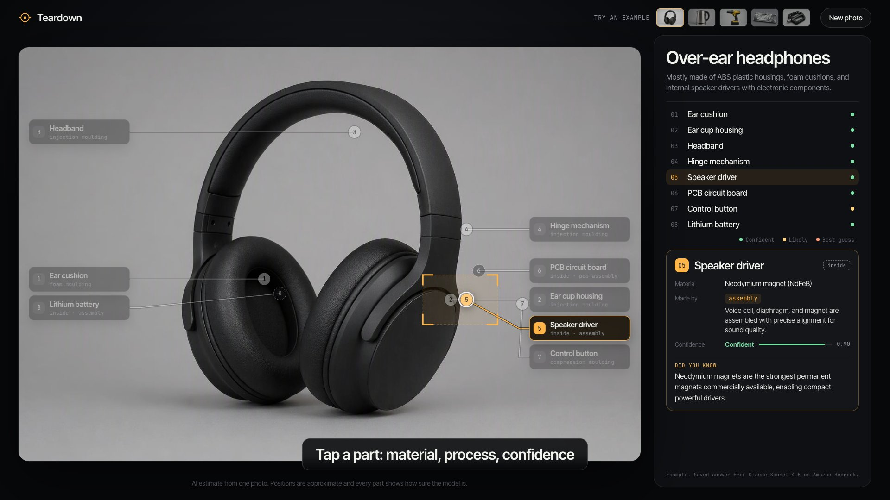

# Teardown

Snap a photo of any everyday object and see what is inside it. Teardown draws numbered callouts onto your own photo for each main part, tells you what every part is made of and how it was manufactured (injection moulding, stamping, die casting, PCB assembly and so on), says how sure it is, and shows a short journey from raw material to your desk. One page, one action. Built for the Devpost "Build With AI: Basics" hackathon, planned first with the Devpost Learn skill pack.



## Try it

Requirements: Node 20.6 or newer, and an Amazon Bedrock API key (bearer token) with access to Claude Sonnet 4.5.

```
npm install
cp .env.example .env      # then put your AWS_BEARER_TOKEN_BEDROCK in .env
npm run dev               # API on http://localhost:8303, app on http://localhost:5303
```

Open http://localhost:5303, drop a photo (or click to choose one; on a phone you can use the camera), or click one of the five examples. The examples work without a key because their answers are saved.

Other commands:

| Command | What it does |
|---|---|
| `npm test` | Validator checks, plus every saved example answer must pass the same rules |
| `npm run build` | Type check and static build to `web/dist` (set `VITE_API_URL` to where the API runs) |
| `npm start` | API only, port 8303 (`PORT` to change) |
| `npm run samples:images` | Regenerate the five sample photos |
| `npm run samples:cache` | Run the real model on each sample photo and save the answers |
| `node output/record.mjs` | Record the screen film (needs `npm run dev` running) |

## How it works

```
 Browser (React + Vite, port 5303)                 Node API (port 8303)                 Amazon Bedrock
 ┌───────────────────────────────┐   POST          ┌──────────────────────────┐  Converse ┌──────────────────────┐
 │ DropZone  > scale to 1280 px  │ /api/teardown   │ index.mjs                │  image +  │ Claude Sonnet 4.5    │
 │ (image.ts)  JPEG base64       │ ──────────────> │ bedrock.mjs: forced tool │ ────────> │ answers by calling   │
 │                               │                 │ "report_teardown"        │ <──────── │ report_teardown with │
 │ Overlay   < callouts on photo │ <────────────── │ schema.mjs: validate,    │   JSON    │ JSON in the schema   │
 │ PartPanel < list + part card  │  { result,      │ retry once with errors   │           └──────────────────────┘
 │ Journey   < raw material>desk │    usage, ms }  └──────────────────────────┘
 └───────────────────────────────┘
   Examples: web/public/samples/<id>.jpg + <id>.json (saved real answers, no server call)
```

- The model answers through a forced tool call whose input schema is the Teardown shape: object, summary, 4 to 10 parts (name, normalised bounding box, material, process from a fixed list, one line on how it is made, confidence 0 to 1, fun fact, inside or visible), and a 4 to 6 step journey.
- `server/schema.mjs` checks the answer (counts, ranges, allowed processes, non empty text). If it fails, the server asks again once with the list of errors.
- The page puts each dot at the centre of its box, sends each label to the side of its dot, spaces labels so they never overlap, swaps label slots when leader lines would cross, and draws everything in one after another.
- Confidence shows as a word on every part: Confident (0.8 and up), Likely (0.6 to 0.8), Best guess (under 0.6).
- No accounts, no database. The result lives in the page and is gone on reload.

## How the plan was made (Devpost Learn skill pack)

This repo started as an empty folder. The first command was `npx skills add challengepost/learn-ai-basics --all -y`, which installed six skills (`.claude/skills/1-start` to `6-ship`; the same files also landed in `.agents/skills` and `agent/skills`). They were run in order:

1. `1-start` interviewed the builder and wrote a learner profile (kept out of git on purpose, as the skill asks).
2. `2-scope` wrote [scope.md](scope.md): the kernel (the answer is drawn on your own photo, with an honest confidence label), the user, the cut list.
3. `3-prd` wrote [prd.md](prd.md): the core journey, the screens, look and feel, states and edge cases.
4. `4-spec` wrote [spec.md](spec.md): stack, components, data shape, the exact Bedrock call, failure modes, and one named uncertainty (are model bounding boxes good enough for dots?).
5. `5-build` turned the spec into five slices in [devpost/checklist.md](devpost/checklist.md); each was built, checked and committed. Plan changes found during the build are listed there under Revisions. [devpost/app-map.html](devpost/app-map.html) is the take home map of the code.

The canonical copies live in `devpost/`; `scope.md`, `prd.md` and `spec.md` at the repo root are copies for the submission requirement. A condensed record of the interview questions and answers is in [devpost/interview-log.md](devpost/interview-log.md).

Assumption, stated plainly: the skills ask the builder questions one at a time. In this build the answers were given on Konstantin's behalf by the coding agent, taken from his written project plan (idea, audience, look, cuts). The documents are the skills' output from those answers.

## The film

`output/teardown-screen.mp4` (1920x1080, 30 fps, about 1:52) is recorded by `output/record.mjs`: Playwright opens the app with `?film=1`, which exposes `window.__film` and hands the animation clock to the recorder. Every frame is stepped, screenshotted and piped into ffmpeg, so the film is identical on every run. The film uses the saved example answers (real model outputs from `npm run samples:cache`); no model call happens while recording. The cursor and the dragged photo are drawn by film mode, not a real mouse. Stills are in `output/stills/`.

## Cost and speed (measured)

From the server log and the saved sample answers: each photo used 3,028 to 3,392 input tokens and 82 (no object) to 1,622 output tokens. At Sonnet 4.5 list prices ($3 and $15 per million tokens) that is about $0.03 per photo, and the answer took 20 to 25 seconds. All Claude calls made during this build (five sample answers, three upload tests) came to about $0.21, not counting the five sample photo generations.

## Tests

`npm test` runs `scripts/test-schema.mjs`: nine validator checks (good answer passes, too few parts, unknown process, confidence and box ranges, clamping, "none" objects, short journeys) plus a check that each saved example passes. End to end checks were run with Playwright against the dev server: a real upload through the file input (answer drawn in about 20 s), a blank grey image (shows "Could not find parts in this photo"), and all five examples.

## Limitations

- Positions are approximate. A language model returns rough boxes, not outlines. Big visible parts land well; small parts can drift (on the keyboard example the knob dot sits above the knob), and hidden parts (drivers, PCBs, batteries, heating elements) are placed where they are likely to be and drawn with a dashed dot.
- Materials, processes and fun facts are the model's best estimate from one photo and are not fact checked. Some numbers in fun facts may be loose.
- None of the five examples has a part under 0.6 confidence, so the "Best guess" wording exists and is tested in code but does not appear in the film.
- The sample photos are AI generated (see Attribution); they are clean studio shots, which is easier than a real desk photo.
- A live answer takes 20 to 25 seconds; the page shows a scanning state the whole time.
- No share links, history or accounts. Reload starts over.
- Not deployed. The static build and the API are ready for it, but no hosting was set up (see Open items).
- On phones the labels on the photo shrink to number chips; names are in the list below the photo.
- HEIC photos from iPhones work only where the browser can decode them (Safari yes, Chrome on desktop no).

## Open items for the owner

- [ ] Confirm the hackathon submission period had opened by Oct 7, 2026 (repo start date). If it opened later, the "new project in the window" rule may need a fresh repo.
- [ ] Run the hands-on checks yourself (`npm run dev`, try a real photo from your desk) and record anything to change in `devpost/checklist.md`.
- [ ] Create the public GitHub repo and push (the `6-ship` skill step): `gh repo create Pytro001/teardown --public --source . --push`.
- [ ] Optional deploy: `VITE_API_URL=<api url> npm run build`, host `web/dist` on Vercel or GitHub Pages, and run `npm start` somewhere Node runs with the Bedrock key set. Never put the key in the web build.
- [ ] Optional: a working `TOGETHER_API_KEY` to regenerate the sample photos with FLUX.1 schnell.
- [ ] Record the face and voice part of the video over `output/teardown-screen.mp4` using `DEMO_SCRIPT.md`, upload, and fill the links in `SUBMISSION.md`.

## Attribution

- Sample photos in `web/public/samples/*.jpg` are AI generated sample images (Azure AI Foundry, gpt-image-2), made by `scripts/make-samples.mjs`. They show no real brand.
- Teardown answers: Claude Sonnet 4.5 on Amazon Bedrock.
- Libraries: React, Vite, TypeScript (all MIT). Fonts: Inter Tight and JetBrains Mono (SIL Open Font License) from Google Fonts. Film: Playwright and ffmpeg.
- Planning skills: Devpost Learn "learn-ai-basics" skill pack (`challengepost/learn-ai-basics`), installed into this repo unchanged.

## License

MIT, see [LICENSE](LICENSE).
